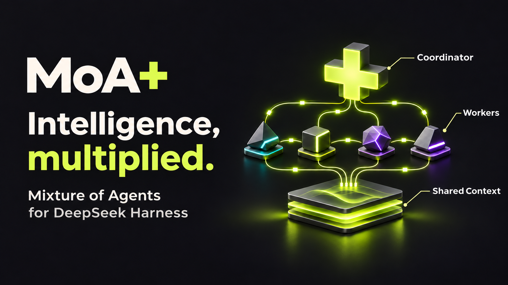
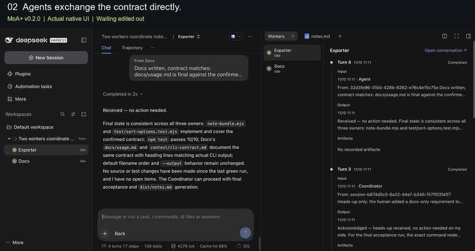
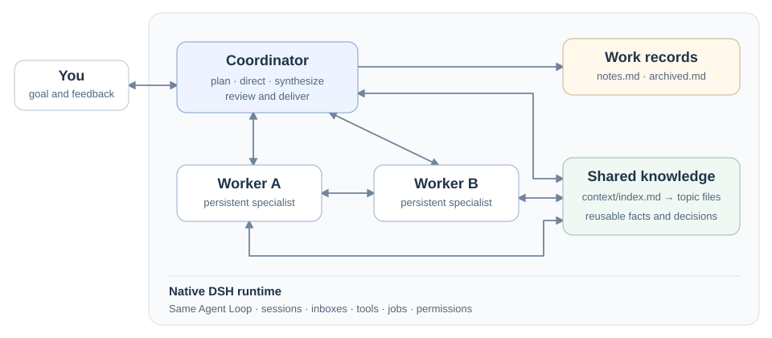

# MoA+

**Advancing intelligence through agent collaboration.**

Watch two Workers build a CLI together, exchange messages directly, and bring a human change back to the Coordinator.

[](docs/media/moa-plus-workflow.mp4)

[Watch the MP4](docs/media/moa-plus-workflow.mp4) · [Reproduce this task](docs/demo-moa-plus.md). Newly recorded in the native DSH interface, revisiting a completed real team task. [Recording details](docs/demo-moa-plus.md#what-the-walkthrough-shows).

MoA+ is a **Mixture of Agents collaboration plugin for DeepSeek Harness**. It connects persistent agents through independent contexts, direct communication, and shared knowledge, with the goal of expanding what the whole system can accomplish together.

A Coordinator keeps the goal and overall direction in view. Workers investigate, build, challenge, and review in their own conversations, remaining available for the next assignment. The team can explore different approaches, work in parallel, and carry its findings into later tasks.

English | [简体中文](README.zh.md)

[Quick start](#quick-start) · [How it works](#how-it-works) · [Demo](#see-it-in-action) · [Documentation][roles]

## Quick start

MoA+ **v0.2.1** supports the audited **DSH 0.2.1-rc.3** and
**DSH 0.2.2-rc.1 / DSH Next 2.0.22-next** compatibility profiles. The rc.3
profile extends **21 native packages across 49 file paths**. Keep the plugin
and its matching profile from the same release; a stock or differently prepared
runtime cannot substitute for it. See [native compatibility profiles](docs/native-compatibility.md)
for Desktop preparation and the exact supported artifacts.

Requires **Node 24.9+**, npm, and Git. The isolated Web launcher below prepares the pinned rc.3 runtime; Desktop Next uses the separate matching profile.

Protected Worker shell execution requires macOS Seatbelt or Linux bubblewrap. Windows filesystem record protection remains available, but the current Windows shell backend cannot enforce the same record exclusions. A Verifier can continue through native file inspection when commands are optional; required command verification reports the missing capability and stops without dropping protection or requesting wider access. See [backend requirements][compatibility].

The commands below use the v0.2.1 checkout. Use `main` instead to follow development.

Clone the project and prepare a separate Web runtime:

```sh
git clone --branch v0.2.1 --single-branch https://github.com/Burns1028/moa-plus.git
cd moa-plus
npm ci
node scripts/apply-native-compat.mjs --dry-run
node scripts/apply-native-compat.mjs --backup "$PWD/.superpowers/native-backup"
npm run build
node scripts/project-mode.mjs setup --dir /absolute/empty-moa-runtime
node scripts/project-mode.mjs start --dir /absolute/empty-moa-runtime
```

The compatibility command backs up the changed files before extending this checkout's dependencies. Setup prepares an isolated runtime with its own home, configuration, documents, and native backups; it leaves your personal Desktop app and `~/.dsh` profile untouched. Use an empty directory outside the checkout and reuse the same `--dir` for subsequent commands.

Configure the model in native settings, create a conversation, and select **MoA+** before its first message. Mode identity stays fixed after starting. Use a Git workspace for isolated Workers; choose `shared` when they should work directly in the parent's directory. The [first-run guide][quickstart] covers model setup, `doctor`, and recovery; [compatibility][compatibility] covers manual setup and rollback.

For the earlier published Project Mode, follow the [v0.1.23 installation instructions](https://github.com/Burns1028/moa-plus/tree/v0.1.23#quick-start). That tag uses the Project label and the earlier three-extension runtime.

## How it works



### Independent work, direct communication

Coordinator and Workers use the same native Agent Loop, with different identities, tools, and delegated permissions. `Task` starts a specialist with a fresh context; `Fork` branches selected committed history. Independent Git worktrees separate parallel changes, while an explicit shared workspace lets Workers use the parent's directory.

`SendMessage` lets agents notify peers, steer work, queue instructions, or ask a blocking question that waits for an explicit reply. `QueryAgent` inspects state and selected history, or waits for progress. `KillAgent` stops execution and waits for resources to exit. Slow tools can run in the background and return their results automatically.

When a Worker turn finishes, its **complete final AI message** returns automatically to its designated reporting Agent. The Coordinator can review the result, continue with that Worker, or change direction. Retained conversations and workspaces let the team continue across assignments.

### Adaptive coordination and optional patterns

Adaptive guidance keeps simple work direct. For delegated work, the Coordinator prefers `SendMessage` to reuse a suitable Worker, `Fork` when committed history helps a new branch, and a fresh `Task` when clean context matters. It starts independent ready branches within native capacity, unlocks dependent work as results arrive, and uses native `QueryAgent` waits when waiting is useful. When no actionable goal or unfinished concrete work exists, a brief acknowledgement or ordinary chat clarification can complete the response without ceremonial tools, memory updates, or blocking questions.

An enabled MoA+ Coordinator also offers five bundled `@` prompts: **并行攻坚** for independent slices, **多方会审** for a disputed decision, **协同探索** for tangled exploration, **迭代精修** for iterative artifact review, and **统筹推进** for a task with several collaboration phases. Type `@` and select the Chinese-named candidate by click, Enter, or Tab. The prompt expands into editable composer text; add the task and send normally. Workers and ordinary conversations do not offer these packs.

These are local prompt texts using the existing tools and role presets. Native sending, file references, uploads, queue, and steer retain their usual behavior. See the [orchestration guide][orchestration] for pattern boundaries and examples.

### Shared knowledge, independent review

The Coordinator maintains `notes.md` and `archived.md`; the Host refreshes full notes before each Coordinator inference. Coordinator and Workers contribute reusable findings through `context/index.md`, then read relevant files as needed. Isolated Workers access the same shared knowledge, so later work can build on confirmed findings without copying every execution detail into the main conversation.

A Rubric Builder derives acceptance criteria from the original requirements and specification. An Outcome Verifier checks actual deliverables with native tools and returns concrete gaps when results are incomplete or evidence is missing. See [roles and common flows][roles], the [code architecture][architecture], and the [Tool API][tools] for the full contracts.

## See it in action

Select the compact **MoA+ wordmark** before the first message: gray is off and green is on. A started MoA+ conversation keeps it as its fixed identity. The transparent control follows light and dark themes, including while hovered.

MoA+ keeps collaboration in the native DSH interface. **Capsules are child conversations**: click one to open its Worker, or find the same Worker beneath the Coordinator in the sidebar. You can give the Worker instructions directly and use Back to return to the Coordinator. Capsules stay with the turn or message segment where the Worker participated.

Agent messages show their sender and expand from an original-text preview to full Markdown. The closable Workers and notes.md tabs show inputs, final replies, artifacts, and current work records. New user input remains responsive while the team works.

The demo starts with the wordmark's off/on states and theme adaptation, then opens the retained Note Bundle task to show capsules, Worker conversations, original Agent messages, the Workers timeline, notes, and results. In that real run, Exporter implemented title sorting, Docs wrote the guide, a human added instructions inside Docs, and the Coordinator checked the Worker history before verifying the result. The recording revisits that execution without starting a new model task. See the [task and actual checks](docs/demo-moa-plus.md) or [runtime verification][verification]. The earlier Project Mode recording remains in the [v0.1.23 demo archive](docs/demo-workflow.md).

## Documentation and contribution

- [Roles, lifecycle, and common flows][roles]
- [Adaptive coordination and optional `@` patterns][orchestration]
- [Code architecture][architecture] and [Tool API][tools]
- [First-run guide][quickstart] and [compatibility / rollback][compatibility]
- [Verification records][verification]
- [Build, tests, and contribution guide][contributing]
- [Report a trial or installation problem](https://github.com/Burns1028/moa-plus/issues/new?template=project-mode-trial.yml)

MoA+ is an unofficial DSH plugin. The package name `dsh-plugin-project-mode` and saved protocol identifiers remain compatible with existing data.

MIT. See [LICENSE](LICENSE) and [third-party notices](THIRD_PARTY_NOTICES.md).

[roles]: https://github.com/Burns1028/moa-plus/blob/main/docs/moa-architecture.md
[orchestration]: docs/orchestration.md
[architecture]: https://github.com/Burns1028/moa-plus/blob/main/docs/architecture.md
[tools]: https://github.com/Burns1028/moa-plus/blob/main/docs/tool-api.md
[verification]: https://github.com/Burns1028/moa-plus/blob/main/docs/verification.md
[compatibility]: https://github.com/Burns1028/moa-plus/blob/main/docs/compatibility.md
[quickstart]: https://github.com/Burns1028/moa-plus/blob/main/docs/quickstart.md
[contributing]: https://github.com/Burns1028/moa-plus/blob/main/CONTRIBUTING.md
