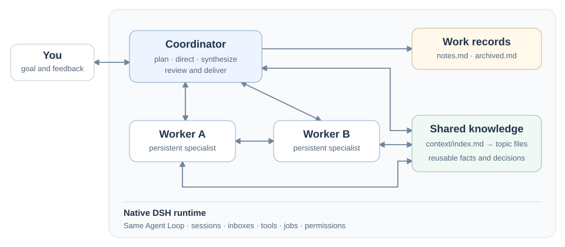

# MoA+

**通过多智能体协作，让智能更进一步。**

MoA+ 以 DeepSeek Harness 插件的形式构建多智能体系统（Mixture of Agents）。常驻的 Coordinator 统筹方向，专长不同的 Workers 探索、执行、提问和审阅。它们保有各自的会话，可以直接交换消息，并把有价值的发现沉淀为下一次任务能复用的知识。

[English](README.md) | 简体中文

[架构与角色][roles] · [试用新运行时](#试用新运行时) · [观看真实协作](docs/media/project-workflow.mp4) · [验证记录][verification]

**开发预览：**新 MoA 运行时位于 `feat/moa-whitepaper` 分支，正在 [PR #3](https://github.com/Burns1028/moa-plus/pull/3) 中接受审阅，需要配套的 DSH **0.2.1-rc.3 兼容运行时**。最新已发布 tag **v0.1.23** 是此前的 Project Mode 预览版。详见[版本与兼容说明][compatibility]。

## 为什么要组织一支团队？

长程任务会持续消耗 Agent 的上下文、判断力和吞吐。MoA+ 从协作方式上应对这三个问题：

- **让全局判断保持清楚。** 工具输出与反复试错留在 Worker 的执行上下文中，Coordinator 持续掌握目标、决策与进度。
- **保留独立视角。** 用干净上下文重新审视一个方向，或继承有用历史探索另一条路径；独立审阅从原始要求出发，检查实际结果。
- **让并行工作产生积累。** 隔离 worktree 分开互相冲突的改动，共享知识索引把确认过的发现带到后续任务。

目标是通过 Agent 之间的配合，提升整个系统解决复杂问题的能力。这套架构为协作提供持续的记忆、通信和控制。



Coordinator 与 Worker 使用相同的原生 Agent Loop，由身份、工具集合和继承权限形成不同职责。用户也可以进入 Worker 直接下达指令，再回到 Coordinator。

## 协作工具

| 原语 | 团队可以做什么 |
| --- | --- |
| `Task` | 以干净上下文创建承担明确职责的专家。 |
| `Fork` | 从选定 Agent 已提交的历史中派生另一条工作分支。 |
| `SendMessage` | 通知同伴、引导当前工作、排队追加指令，或提出需要明确答复的阻塞问题。 |
| `QueryAgent` | 查看状态和指定范围的人类／AI 消息，或等待进展与新来信。 |
| `KillAgent` | 停止并等待当前执行退出；保留会话以便继续，也可以显式销毁。 |

Worker 在多次分工之间保留会话与工作目录。每轮真正结束后，系统把**本轮最后一条完整 AI 消息**送给指定的汇报对象。Coordinator 可以审阅结果、沿用这个 Worker，或调整方向。团队工作期间，新的用户输入仍能及时接入。

运行时还提供隔离／共享工作区、慢工具转后台及结果自动回流、共享知识和独立完成审阅。Coordinator 保留普通执行工具，自行判断如何分工；确实需要多级团队时，再显式开启嵌套派生。详见[角色与操作流程][roles]、[工具 API][tools]。

## 协作仍然发生在对话中

MoA+ 沿用 DSH 原生界面：

- **胶囊就是子会话。** 点击胶囊进入 Worker；原生左侧列表中，同一个 Worker 显示在 Coordinator 下。胶囊保留在它参与工作的 turn／消息段中。
- **对话里能看到 Agent 来信。** 主会话、Worker 与同伴的来信标明发送者；先展示原文预览，点击展开完整 Markdown。
- **工作过程可以检查。** 右侧默认打开可关闭的 Workers 与 notes.md 标签页，展示工作轴和当前记录；输入与输出使用紧凑、可展开的预览。
- **用户可以直接参与。** Worker 继承权限，通过 Back 返回 Coordinator。删除后隐藏对应有效列表项及胶囊，归档则跟随 Coordinator 的会话家族。

[](docs/media/project-workflow.mp4)

这段 **v0.1.23** 录屏展示真实任务：Exporter 修改 CLI 的标题排序；用户进入它的会话调整约定；Docs 对齐文档；Coordinator 审阅结果。下一次任务继续复用这些 Workers 与已经达成的上下文。[实际产物](docs/demo-result)通过了九项测试。

这是省去等待并加以标注的 60 秒剪辑，展示此前的协作流程，保留当时的 Project 标识。新运行时的证据单列在[验证记录][verification]中，也可以[复现这次演示](docs/demo-workflow.md)。

| Worker 工作轴 | 共享工作记录 |
| --- | --- |
|  |  |

这两张细节图来自 v0.1.22 的虚构 Project Atlas 验收工作区；当前模式名称为 MoA+。

## 试用新运行时

需要 **Node 24.9+**、npm 和 Git。通过待审分支，在独立 Web 环境中试用：

```sh
git clone --branch feat/moa-whitepaper --single-branch https://github.com/Burns1028/moa-plus.git
cd moa-plus
npm ci
node scripts/apply-native-compat.mjs --dry-run
node scripts/apply-native-compat.mjs --backup "$PWD/.superpowers/native-backup"
npm run build
node scripts/project-mode.mjs setup --dir /absolute/empty-moa-runtime
node scripts/project-mode.mjs start --dir /absolute/empty-moa-runtime
```

启动器准备独立的运行时、home、配置和文档目录。在原生设置中配置模型，新会话发送首条消息前选择 **MoA+**；启动后模式身份固定。隔离 Worker 需要 Git 工作区；需要直接操作父目录时显式选择 `shared`。

配套兼容清单目前覆盖 13 个原生包、31 个文件路径。安装流程在选定环境内备份并应用经过审阅的扩展，不安装到个人 Desktop 应用。原版 rc.3 或其他插件版本准备的运行时不能替代。模型配置、`doctor`、环境选择和回滚步骤见[首次运行指南][quickstart]。

试用**此前已发布的预览版**，请使用 [v0.1.23 tag 及其安装说明](https://github.com/Burns1028/moa-plus/tree/v0.1.23#quick-start)。它保留 Project 标识，使用此前的三个兼容扩展，不包含这里介绍的新运行时。

## 让记忆延续到下一次工作

```text
workspace/
├── notes.md                 当前目标、分工、进度和阻塞
├── archived.md              告一段落的工作及结果
├── rubrics.md               独立生成的验收标准
└── context/
    ├── index.md             共享知识的位置与简短介绍
    └── ...                  可复用的发现、决策和方法
```

Coordinator 维护 notes 与 archive。Host 在它**每次推理前完整注入 notes**；超过 8,000 字符的软预算时提醒整理归档，保留全文。Workers 把有复用价值的发现写入 Context，Coordinator 负责整体合并、整理和删除过时信息。Agent 先读索引，再按需读主题文件；隔离 worktree 中也能访问同一份共享知识。

已有保存路径与旧上下文索引继续兼容。独立项目使用独立工作区；相同工作区中的会话共享工作记录和知识。

## 阅读与参与

[代码架构][architecture]说明模块、结构体、权责和六条控制流。[验证记录][verification]区分自动测试、真实模型任务、浏览器验收与历史版本证据，覆盖请求与回复、后台结果、取消、独立审阅、正常收口和重启去重。

- [角色、生命周期与常见流程][roles]
- [工具契约][tools]
- [兼容与回滚][compatibility]
- [构建、测试与贡献指南][contributing]
- [反馈真实试用或安装问题](https://github.com/Burns1028/moa-plus/issues/new?template=project-mode-trial.yml)

MoA+ 是非官方 DSH 插件。历史包名 `dsh-plugin-project-mode` 与已保存的协议标识保持稳定。我们希望通过协作提升系统智能，具体团队的表现仍取决于模型判断和实际任务结果。

MIT。见 [LICENSE](LICENSE) 与[第三方声明](THIRD_PARTY_NOTICES.md)。

[roles]: https://github.com/Burns1028/moa-plus/blob/feat/moa-whitepaper/docs/moa-architecture.md
[architecture]: https://github.com/Burns1028/moa-plus/blob/feat/moa-whitepaper/docs/architecture.md
[tools]: https://github.com/Burns1028/moa-plus/blob/feat/moa-whitepaper/docs/tool-api.md
[verification]: https://github.com/Burns1028/moa-plus/blob/feat/moa-whitepaper/docs/verification.md
[compatibility]: https://github.com/Burns1028/moa-plus/blob/feat/moa-whitepaper/docs/compatibility.md
[quickstart]: https://github.com/Burns1028/moa-plus/blob/feat/moa-whitepaper/docs/quickstart.md
[contributing]: https://github.com/Burns1028/moa-plus/blob/feat/moa-whitepaper/CONTRIBUTING.md
