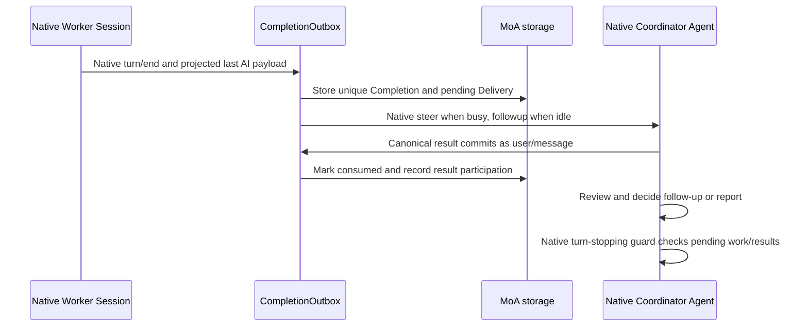

# Code architecture and reading guide

The current MoA+ implementation is a Cordis Host/Client plugin built on DSH's native Agent Loop, Sessions, subagent manager, inboxes, projections, filesystem and workspace registry. The Coordinator is a role assigned to an ordinary native Agent. A Worker is a native continuable child Session, not a second execution engine.

The rename changes the public brand and repository URL. Existing `dsh-plugin-project-mode` package/module IDs, the `project-mode` Cordis entry, `projectMode` Remote methods and stored MoA paths remain stable. Owned types/classes and source modules use `MoA*` and `moa-*` names under `packages/moa`. Old public type names survive only as aliases in `shared/legacy-types.ts`; `client/compat.ts` isolates the legacy Remote namespace. The stored `project`/`projectId` fields describe existing records and are read without migration. `scripts/moa.mjs` is the canonical launcher; the old entry forwards to it.

For the system goal, current role responsibilities and shared context, start with [MoA+ goals and current roles](moa-architecture.md). This guide explains the current implementation. The baseline is DSH 0.2.1-rc.3 with the explicit extensions in [compatibility](compatibility.md).

## Repository layout

```text
packages/moa/
  src/host/       Coordination, native integration and persisted MoA facts
  src/client/     Remote subscriptions, derived UI state and native slot contributions
  src/shared/     Host/Client transport types
  lib/            Generated Host, browser factory, Remote descriptors and declarations
  cordis.patch.yml  Cordis service composition
compat/rc3/       Reviewed native compatibility patches and exact file hashes
scripts/         Build, explicit compatibility application and install-consumer checks
tests/           Real DSH integration, native Client contracts and UI regressions
```

The repository root is a private npm forwarding package for Git installation. `packages/moa` is the installable Cordis bundle. `scripts/build.mjs` compiles source and generates Remote artifacts; `scripts/prepare-release.mjs` forwards package metadata and copies release documentation. Built files are committed because Git installation has no build/prepare hook. Edit source, then regenerate; do not hand-edit `lib`.

## Main modules and entry points

| Module                                                                                                                                                                                       | Responsibility                                                                                          | Start reading at                                                                                                                    |
| -------------------------------------------------------------------------------------------------------------------------------------------------------------------------------------------- | ------------------------------------------------------------------------------------------------------- | ----------------------------------------------------------------------------------------------------------------------------------- |
| [host/index.ts](../packages/moa/src/host/index.ts)                                                                                                                                           | Service composition, Agent-scoped tool mounting, recovery and authorized Remote boundary                | `MoAPlugin[Service.init]`, `attach`, `recover`, typed Remote wrappers                                                               |
| [host/agent-events.ts](../packages/moa/src/host/agent-events.ts)                                                                                                                             | Native event subscriptions and canonical result normalization before a model step                       | `bindAgentEvents`, `normalizeCoordinatorStep`                                                                                       |
| [host/moa-lifecycle.ts](../packages/moa/src/host/moa-lifecycle.ts)                                                                                                                           | MoA mode queries, permanent identity and draft enable/disable maintenance                               | `MoALifecycle.mode`, `setEnabled`, `requireCanDisable`, `createRecord`                                                              |
| [host/moa-views.ts](../packages/moa/src/host/moa-views.ts)                                                                                                                                   | Pure snapshot assembly from already-observed native and durable facts                                   | `buildMoASnapshot`                                                                                                                  |
| [host/worker-operations.ts](../packages/moa/src/host/worker-operations.ts)                                                                                                                   | Validate and own Worker operations, serialize per-Worker mutations, persist admission receipts          | `controlForAgent`, `dispatch`, `prepareAssignment`, `admitWorkerInput`, `interruptOrDelete`, `acceptReceipt`, `reconcileAssignment` |
| [host/completion-outbox.ts](../packages/moa/src/host/completion-outbox.ts)                                                                                                                   | Collect ended turns, persist canonical results, admit them to the Coordinator and recognize consumption | `CompletionOutbox.ingest`, `deliver`, `consume`                                                                                     |
| [host/turn-coordination.ts](../packages/moa/src/host/turn-coordination.ts)                                                                                                                   | Hold normal native closure until MoA work/results settle; freeze historical outcomes                    | `TurnCoordination.guardTurn`, `freezeTurn`                                                                                          |
| [host/native-receipt.ts](../packages/moa/src/host/native-receipt.ts)                                                                                                                         | Recognize an already-consumed native result during recovery                                             | `consumedNativeReceipts`                                                                                                            |
| [host/capsule-participation.ts](../packages/moa/src/host/capsule-participation.ts)                                                                                                           | Record participation and repair historical capsule seats from native evidence                           | `participatingMemberships`, `repairCapsuleOwnership`                                                                                |
| [host/moa-memory.ts](../packages/moa/src/host/moa-memory.ts)                                                                                                                                 | Create a missing progressive context index through the acting Agent's scoped filesystem                 | `ensureContextIndex`                                                                                                                |
| [host/worker-activity.ts](../packages/moa/src/host/worker-activity.ts), [history.ts](../packages/moa/src/host/history.ts), [worker-timeline.ts](../packages/moa/src/host/worker-timeline.ts) | Read native input/status, committed dialogue and per-turn UI activity                                   | `readWorkerActivity`, `readHistory`, `readWorkerTimeline`                                                                           |
| [host/moa-archive.ts](../packages/moa/src/host/moa-archive.ts)                                                                                                                               | Synchronize family archival through the native workspace registry                                       | `bindMoAArchives`                                                                                                                   |
| [client/runtime.ts](../packages/moa/src/client/runtime.ts)                                                                                                                                   | Own Remote catalog/mode requests, subscriptions, reconnect and disposal                                 | `MoAClient`                                                                                                                         |
| [client/store.ts](../packages/moa/src/client/store.ts)                                                                                                                                       | Reconcile complete MoA snapshots and derive stable capsule rows                                         | `MoAStore.accept`, `push`, `turn`                                                                                                   |
| [client/index.tsx](../packages/moa/src/client/index.tsx)                                                                                                                                     | Register native UI contributions and lifecycle bindings                                                 | `apply`, `applyMoAClient`                                                                                                           |
| [client/branch.tsx](../packages/moa/src/client/branch.tsx), [components.tsx](../packages/moa/src/client/components.tsx)                                                                      | Native sidebar branch, capsules and MoA/Back controls                                                   | `MoABranch`, `bindMoABranches`, `WorkerCapsuleList`, `MoAToggle`                                                                    |
| [client/panels.tsx](../packages/moa/src/client/panels.tsx), [worker-timeline.tsx](../packages/moa/src/client/worker-timeline.tsx)                                                            | Native right-side tab defaults and the Worker work axis                                                 | `registerMoAPanels`, `WorkersPanel`                                                                                                 |
| [client/worker-parent.ts](../packages/moa/src/client/worker-parent.ts)                                                                                                                       | Retain a cold parent while the user opens a managed Worker                                              | `bindWorkerParents`                                                                                                                 |

`host/control.ts` owns request schemas and the `control_workers` definition; the Service owns Agent-scoped registration. `shared/worker-membership.ts` supplies `isVisibleWorker`, the one predicate for active public lists: deleted members and creation-only failures are omitted, while an existing Worker with a failed execution stays visible. Internal records remain available for recovery.

`host/native.ts` is a small adaptation layer over public native APIs. `host/host-access.ts` is the current shared dependency contract for the extracted Host components. It exposes the Host context and callbacks; the file boundaries are useful, but these components remain coupled through that contract.

## Data structures and ownership

Persisted schemas and their inferred Host types live in [host/state.ts](../packages/moa/src/host/state.ts). Public transport interfaces live in [shared/index.ts](../packages/moa/src/shared/index.ts). Their purposes differ:

| Structure                                   | What it represents                                                                                                      |
| ------------------------------------------- | ----------------------------------------------------------------------------------------------------------------------- |
| `MoARecord` / `moaSchema`                   | MoA identity, Coordinator Session ID, workspace, memory paths, mode lock and revision                                   |
| `Worker` / `workerSchema`                   | Managed child identity and membership lifecycle; execution itself belongs to the native Session                         |
| `assignmentSchema`                          | One spawn/send operation, native message receipt, delivery mode and its originating Coordinator turn/segment            |
| `Completion` / `completionSchema`           | One ended Worker turn, keyed by MoA + Worker + native turn-end sequence, with the full last committed assistant payload |
| `deliverySchema`                            | The durable canonical result message and native admission/consumption status                                            |
| `TurnWorkerMembership` / `membershipSchema` | A Worker's participation in a specific Coordinator turn and human-message segment                                       |
| `TurnWorkerOutcomeView` / `outcomeSchema`   | Frozen outcome for that historical capsule seat                                                                         |
| `RecordState`                               | Stored MoA aggregate: metadata plus Workers, assignments, completions, deliveries, participation and recovery facts     |
| `Projection`                                | MoA facts folded from native Session events: ended turns, last assistant payload and result anchors                     |
| `WorkerView`                                | Current derived membership, activity, availability and UI phase                                                         |
| `MoASnapshot`                               | A complete Client baseline: public MoA metadata, Worker views, memberships, outcomes and current Coordinator activity   |
| `WorkerHistoryPage`                         | Explicit newest-relative `offset`/`limit` over committed user/assistant text                                            |
| `WorkerTimelinePage`                        | UI-only newest-first native turns with original input, final output and recorded artifacts                              |

Native Session events are authoritative for execution and accepted/committed messages. The MoA storage domain records plugin-owned relationships and delivery facts. `notes.md`, `archived.md` and context documents are Agent-maintained project memory; they are not a scheduling database or a source for result deduplication. Client caches are derived presentation state.

### Status vocabulary

A Worker's `lifecycle` describes MoA membership: `provisioning → active`, with `deleting → deleted` and creation failure `provision-failed`. A live Worker whose execution fails can remain an active member.

`status` describes observed native execution (`busy`, `idle`, or unknown `null`). `availability` describes residency/readability (`live`, `cold`, `unavailable`). A cold Session is not inherently unusable; native continuation can resume it. `phase` is a display label derived from those facts and the last outcome. Do not treat these three fields as three independent execution state machines.

Assignment `admission` records native acceptance: `prepared`, `accepted`, `unknown` or `rejected`. `unknown` represents uncertain admission and must be reconciled before repeating a side effect.

Result delivery normally follows `pending → admitted → consumed`. A cancelled result associated with deletion can be `suppressed`. Consumption means the canonical result reached a committed native Coordinator message; it does not assert that the model understood it or completed its review.

## Main execution paths

### Enable MoA

`MoAToggle → MoAClient.toggle → authorized projectMode.setEnabled → MoALifecycle.setEnabled → native Agent maintenance → scoped native filesystem → MoA record → attach`.

The Host validates Session access and revision, creates missing memory files without overwriting existing ones, and registers `control_workers` in the Coordinator Agent scope. `tools.suppress` removes only the configured native Coordinator delegation tools. First owned native turn start locks the session's MoA identity. Draft disable and plugin disposal reverse scoped contributions; they do not rewrite global tool preferences.

### Dispatch work

`control_workers → toolOperationId → WorkerOperations.controlForAgent → dispatch → prepareAssignment → admitWorkerInput → native subagents → acceptReceipt`. Interrupt/delete use `interruptOrDelete` without creating an Assignment.

The native tool-call identity supports operation idempotency. The Assignment is persisted before native admission. Spawn uses `subagents.startActivation`; send uses native next-step steer or next-turn queue. Accepted admission records the native message ID and capsule participation. Acceptance is not task completion. Per-Worker mutation serialization is released after admission; it is not held while waiting for model work.

### Return results and close a turn



`ingestCompletion` preserves the full last committed AI payload; a turn without an AI message still creates a completion notification with an empty result body. The notification identifies its Worker, native turn and outcome.

`admitDeliveries` first checks native history and inbox identity, including already-consumed native notices, before waking a cold Coordinator or admitting a canonical message. `consume` records the original message anchor so a later human input cannot move its capsule. `guardTurn` waits on native change notifications and pending MoA facts, returning control for new steer input or native Stop. It does not create a second Agent Loop.

Native notifications are bound in `agent-events.ts`; its Coordinator pre-step normalization reconciles managed native settlement notices with the canonical persisted result. The Service keeps the generated Remote method signatures and authorization boundary. Snapshot reads gather native facts before passing them to the pure `buildMoASnapshot`.

On startup, `recover` reconciles uncertain assignments, interrupted deletions, historical participation and result delivery. `native-receipt.ts` verifies native notice identity/content rather than guessing from similar text or the time the Coordinator later consumed it.

### Human operation of a Worker

Before processing each new Coordinator human input, including same-turn steer, the Host samples native Worker state into required runtime context. The role prompt also tells the Coordinator to list Workers and read history as needed. The snapshot includes input provenance and pending-input facts; it is not a transcript of every change.

No human read cursor or additional acknowledgement protocol is maintained. The Coordinator uses existing `list/get/history` tools to decide what to inspect and how to update work records. Per-turn automatic result return remains independent of these reads. Exact preview/window behavior is documented in [Tool API](tool-api.md).

## UI boundaries

The Client contributes native slots and tabs. It does not replace the workspace browser, input editor, permissions engine or file preview. Worker permission selection is hidden in managed Worker composers while native delegated policy remains authoritative.

`MoAStore.turn` derives capsules by `(Coordinator Session, native turn, human-message segment, Worker)`. Spawn, accepted updates and received results establish participation. Passive user input and reads do not. Closed seats use frozen outcomes; deleting membership hides all its seats.

The Workers tab consumes a read-only native activity stream. Its timeline shows original Markdown input and the last AI output of each ended turn. Each message uses a native disclosure with a two-line text preview and overflow ellipsis. DSH's native Markdown extractor supplies the preview without summarizing or clipping the stored source; opening renders the original Markdown, including full tables and code, and closing returns to the text preview. Artifact links come from recorded native deliveries/successful file mutations. Opening the tab does not call a model.

## Failure handling and remaining maintenance

Background jobs log failures and notify observers. A historical background warning is not a permanent cross-MoA execution gate. Normal closure uses the current MoA's unresolved assignments, native Worker activity and result-delivery facts. Delivery attempts and errors remain on their durable Delivery records, preserving existing retry and recovery behavior. There is no global `runtime` error latch or parallel error state machine.

The Host entry is reduced from 1,184 to 738 lines, and initialization from 322 to 120 lines. Mode changes, event binding, tool definition and snapshot assembly have named modules, while the native execution order and public/storage contracts remain unchanged.

Remaining localized work includes `repairCapsuleOwnership`, which still combines historical evidence gathering with migration, and the Coordinator pre-step normalization. `HostAccess` remains a shared native capability interface; narrow it further only when an actual responsibility split needs it. Transport enums include values not currently produced by every Host read path; consult actual producers before adding behavior around an enum value.

See [contributing](../CONTRIBUTING.md) for the verification workflow and test map.
