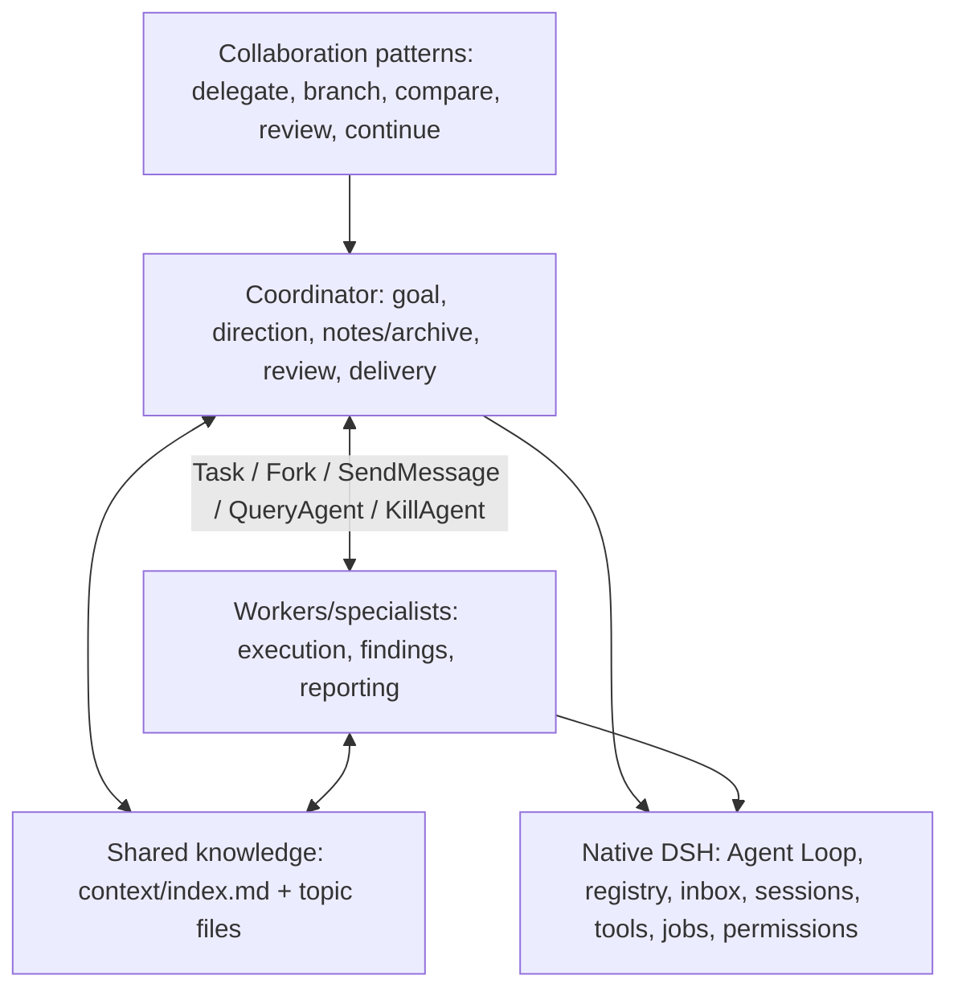

# Code architecture and reading guide

MoA+ organizes persistent Agents into a collaborating team inside DeepSeek Harness. Separate execution contexts preserve room for local exploration; direct communication coordinates the work; indexed shared knowledge carries useful findings forward; independent review checks the delivered result against its original requirements.

The implementation is a Cordis Host/Client plugin over DSH's native Agent Loop, Sessions, inboxes, subagent manager, filesystem, jobs, and workspace registry. Coordinator and Worker use the same runtime. The plugin supplies role composition, collaboration tools, shared knowledge, durable delivery facts, and completion hooks.

This guide describes the current checkout, including the unreleased Worker attachment extension, Adaptive coordination guidance, and bundled orchestration prompts. The published v0.2.0 tag has the earlier runtime; v0.1.23 and its media document the Project Mode preview. Read [compatibility](compatibility.md) for the matching native runtime and [verification](verification.md) for evidence status.

## Three layers



Patterns are decisions made through these tools and role prompts: create a clean specialist, branch useful history, ask a peer, compare results, or continue an existing Worker. The Coordinator retains ordinary execution tools and decides task ownership. Native DSH owns execution ordering, inbox admission, resource cleanup, and permissions; the plugin composes the collaboration around those guarantees.

The default Adaptive guidance prefers suitable retained context through SendMessage, useful committed history through Fork, and clean Task contexts when independence matters. Ready independent work can start in parallel; incoming results unlock dependent work. QueryAgent supplies the native interruptible wait. Simple work can remain with the Coordinator. The five optional [orchestration prompts](orchestration.md) add task-specific collaboration instructions as editable user text, while the native runtime continues to own execution.

## Reading order

| File | Responsibility and main entry points |
| --- | --- |
| [host/index.ts](../packages/project-mode/src/host/index.ts) | `ProjectMode[Service.init]`, `prepareAgent`, `attach`, `recover`, and authorized Remote methods compose the plugin. |
| [host/prompts/](../packages/project-mode/src/host/prompts/) | Coordinator/Worker policies, Builder/Verifier instructions, identity/reporting text, and interrupt-judge instructions. Constants and pure text constructors live here; native message admission, source serialization, attachments and runtime state stay with their services. |
| [shared/orchestration.ts](../packages/project-mode/src/shared/orchestration.ts) | Bundled titles, descriptions, and prompt text for fan-out, panel-team, blackboard-team, critique-loop, and auto-orchestration. This catalog owns text, with no persisted workflow state, remote service, or Skill loader. |
| [host/moa/tools.ts](../packages/project-mode/src/host/moa/tools.ts) | Model-facing definitions for Task, Fork, SendMessage, QueryAgent, KillAgent, and ProjectContext; validate arguments and call the responsible service. |
| [host/moa/agents.ts](../packages/project-mode/src/host/moa/agents.ts) | `MoAAgents.task`, `fork`, `query`, `kill`, `context`, `recover`, and `lifecycle` implement controls through existing native capabilities. |
| [host/moa/roles.ts](../packages/project-mode/src/host/moa/roles.ts) | `applyRoleRestrictions` mounts each specialist's execution-tool boundary. |
| [host/moa/workspaces.ts](../packages/project-mode/src/host/moa/workspaces.ts) | `MoAWorkspaceManager.prepare`, `discoverOwned`, and `destroy` own dirty-state snapshots and cleanup of owned worktrees. |
| [host/moa/messages.ts](../packages/project-mode/src/host/moa/messages.ts) | `MoAMessageBroker` matches explicit replies, waits interruptibly, detects wait cycles, and persists routing/receipts through `createNativeMessageBroker`. |
| [host/moa/residency.ts](../packages/project-mode/src/host/moa/residency.ts) | `withManagedAgent` borrows the actual native parent chain for cold message/result delivery without invented input. |
| [host/moa/judge.ts](../packages/project-mode/src/host/moa/judge.ts) | `judgeInterrupt` makes a short native no-thinking decision about pending input without consuming it or creating an Agent. |
| [host/moa/background.ts](../packages/project-mode/src/host/moa/background.ts) | `bindBackground` binds policy, job queries/cancellation, canonical result receipts, recovery, and teardown to one native Agent. |
| [host/moa/completion.ts](../packages/project-mode/src/host/moa/completion.ts) | `bindCompletion` installs Ralph and the Coordinator's owned independent Builder/Verifier helpers. |
| [host/project-memory.ts](../packages/project-mode/src/host/project-memory.ts) | `memoryPaths`, `accessProjectContext`, `ensureContextIndex`, and `bindProjectMemory` own paths, shared Context I/O, progressive index creation, and full notes admission. Shared writes retain membership, native policy, path containment and conditional-version checks. |
| [host/moa/worker-memory-policy.ts](../packages/project-mode/src/host/moa/worker-memory-policy.ts) | `bindWorkerMemoryPolicy` attaches the project's actual notes/archive paths to the Worker's native session policy and retains protection through joined teardown. |
| [host/worker-operations.ts](../packages/project-mode/src/host/worker-operations.ts) | `spawnMoA` and the existing prepare/admit/accept/reconcile path persist input acceptance and capsule provenance. Legacy backend controls use the same path. |
| [host/completion-outbox.ts](../packages/project-mode/src/host/completion-outbox.ts) | `ingest`, `deliver`, and `consume` persist full ended-turn results and route them once to the designated recipient. |
| [host/agent-events.ts](../packages/project-mode/src/host/agent-events.ts) | `bindAgentEvents` retains native registration order; pre-step normalization reconciles native settlement notices with canonical MoA delivery. |
| [host/turn-coordination.ts](../packages/project-mode/src/host/turn-coordination.ts) | `guardTurn` waits on current project obligations while yielding to input/Stop; `freezeTurn` records historical capsule outcomes. |
| [host/project-lifecycle.ts](../packages/project-mode/src/host/project-lifecycle.ts) | `ProjectLifecycle` owns permanent mode identity and draft enable/disable through native maintenance. |
| [host/project-views.ts](../packages/project-mode/src/host/project-views.ts) | `buildProjectSnapshot` assembles transport views from observed native/durable facts. |
| [host/capsule-participation.ts](../packages/project-mode/src/host/capsule-participation.ts) | `participatingMemberships` and `repairCapsuleOwnership` retain native turn/human-segment anchors. |
| [host/history.ts](../packages/project-mode/src/host/history.ts), [worker-activity.ts](../packages/project-mode/src/host/worker-activity.ts), [worker-timeline.ts](../packages/project-mode/src/host/worker-timeline.ts) | Explicit dialogue windows, current input provenance, and read-only work-axis projections. |
| [host/project-archive.ts](../packages/project-mode/src/host/project-archive.ts) | Family archival through the native workspace registry. |
| [client/runtime.ts](../packages/project-mode/src/client/runtime.ts), [store.ts](../packages/project-mode/src/client/store.ts) | Remote subscriptions/reconnect and derived complete-snapshot/capsule caches. |
| [client/index.tsx](../packages/project-mode/src/client/index.tsx), [branch.tsx](../packages/project-mode/src/client/branch.tsx), [components.tsx](../packages/project-mode/src/client/components.tsx) | Native slot contributions: original sidebar rows, capsules, MoA+/Back controls. |
| [client/orchestration-input.ts](../packages/project-mode/src/client/orchestration-input.ts) | `bindOrchestrationInput` registers a native `@` input-trigger source for enabled Coordinators, returns catalog candidates, and expands a picked candidate into composer text. Native Send remains the composer owner's operation. |
| [client/tail.ts](../packages/project-mode/src/client/tail.ts), [agent-message.tsx](../packages/project-mode/src/client/agent-message.tsx) | Existing Worker-tail renderer displays incoming MoA messages with their actual sender and expandable original Markdown, retaining the same capsule seats. |
| [client/panels.tsx](../packages/project-mode/src/client/panels.tsx), [worker-timeline.tsx](../packages/project-mode/src/client/worker-timeline.tsx) | Default closable native tabs and expandable original Markdown input/output. |

`host/native.ts` is the version-sensitive adapter boundary. `HostAccess` supplies native capabilities and the Host callbacks used by extracted components. It is not a parallel execution engine. `host/control.ts` retains legacy backend request schemas; it no longer defines a model-visible `control_workers` tool.

## Durable facts and derived views

[host/state.ts](../packages/project-mode/src/host/state.ts) owns persisted schemas; [shared/index.ts](../packages/project-mode/src/shared/index.ts) owns transport views.

| Structure | Owner and lifetime |
| --- | --- |
| `ProjectRecord` / `projectSchema` | Root Session identity, workspace/memory paths, permanent mode lock, revision. Historical name retained. |
| `Worker` / `workerSchema` | Managed membership (`provisioning`, `active`, `deleting`, `deleted`, `provision-failed`), not execution state. |
| `AgentDescriptor` | Actual creator, `reportTo`, role, nested permission, workspace mode/ownership, and Fork source facts. Stored in existing project operations. |
| `MoAWorkspaceRecord` | Shared source reference or owned isolated worktree, branch, Git common directory, and owner identity. |
| `assignmentSchema` | One prepared input operation and its native acceptance ID, delivery mode, turn, and human-message segment. |
| `Completion` | One real ended Worker turn, keyed by Worker and native turn-end sequence, containing its complete last committed AI payload. |
| `deliverySchema` | Canonical result, recipient, admission/consumption state, attempts, and diagnostics. Legacy missing recipient means Coordinator. |
| `RequestRoute` | Request ID, sender/receiver, waiting/ended/answered route, and explicit answer; retained for late replies/recovery. |
| `BackgroundResultData` | Full canonical native result and stable identified delivery persisted in the owning Session. |
| Completion input/criteria records | Task identity, original human/spec snapshots, exact promise, and current task state; stored in existing operations. |
| `RecordState` | Persisted aggregate of plugin-owned relationships, admissions, results, and recovery facts. |
| `Projection` | Fold of native events: turn boundaries, committed inputs/finals, handoff carry-over, and capsule anchors. |
| `WorkerView` / `ProjectSnapshot` | Derived native activity, membership, availability, progress, and UI state. |
| `WorkerHistoryPage` / `WorkerTimelinePage` | Explicit human/AI message windows versus UI native turns and artifacts. |

Native Session events are authoritative for execution and accepted/committed messages. Project storage records collaboration and delivery facts. `notes.md`, `archived.md`, and context files are Agent-maintained knowledge/work records, not a result-dedup database. Client caches derive from complete Host snapshots.

Five-state lifecycle is derived from native activity, approval/query waits, cancellation cleanup, and history. Request's awaited Tool Call remains **Running**; Query/human approval can be **Waiting**. **Aborting** lasts through actual cleanup. **Zombie** retains conversation/workspace without active model execution; SendMessage resumes it. A newly created Agent with no run is **Idle**. Membership, native busy/idle, cold residency, and display phase remain distinct facts.

## Composition and admission

`ProjectLifecycle.setEnabled → native maintenance → memory files/project record → prepareAgent → scoped tools/background/completion bindings`.

The first owned turn locks mode identity. Creation and mode enable await bindings before native tool-schema assembly. Role identity is dialogue: Task first; Fork after inherited history. The five controls replace alternative native delegation in managed scopes; nested control tools default off. Draft disable/unload reverses scoped contributions and drains owned work without editing global preferences.

Orchestration expansion is a Client input contribution, not a Host scheduling path. Click, Enter, or Tab selection produces editable text before sending. The source is scoped to enabled MoA Coordinators; Workers and ordinary conversations keep their native input behavior. Ordinary file references, uploads, queue/steer, and native Send are unchanged. The selected text instructs the Coordinator to pass each member its own responsibility through `tasks[].task` (or Fork's `task`), using existing role presets. A Lead or Keeper is created first so later members can use its actual ID as `reportTo`; that reporting edge does not transfer direct-child management authority. The catalog does not enforce communication topology or add runtime state.

Task/Fork reserve stable identities and persist descriptor/workspace facts before native activation. `WorkerOperations` prepares an assignment before accepting input, records its native receipt, and establishes capsule participation. Per-Worker mutation ordering ends after admission; it is not held for the whole model task. Fork's temporary recovery seed is removed only after confirmed native acceptance. Uncertain acceptance is reconciled against persisted native evidence before retrying.

Isolated preparation snapshots the source's current tracked/staged/untracked state using an independent Git index. Git commands use the acting native sandbox policy. Owned markers identify cleanup resources; destruction never removes a shared source. For explicitly permitted nested creation, management is scoped to the project's Git resources while ordinary execution keeps the child's own cwd policy. Read-only mode remains read-only; foreign Git resources outside the permitted project boundary are rejected.

## Messages and result return

Notify admits an identified message and returns. Request persists its route, admits input, and waits inside the native Tool Call. Explicit `reply_to` resolves that call; unrelated input can interrupt the wait, and a late answer is delivered through the inbox. Request owns this wait: its interrupted Tool Result continues the current turn. In PTC mode, `SendMessage` remains a direct native tool beside `run_code`, with no script binding. This preserves the whole Request call across script startup and persistence, without a second wait tracker. A wait-cycle check downgrades the new cyclic wait to Notify. The native pre-step drains all eligible next-step input; explicit next-turn queue input remains separate.

`withManagedAgent` reads durable headers and borrows the true parent chain, including cold intermediate parents. The reviewed Host-only native callback preserves reconstruction, delegated policy, capacity, and cleanup. It does not create synthetic user prompts or task events for intermediate hydration.

```mermaid
sequenceDiagram
    participant W as Native Worker
    participant O as CompletionOutbox
    participant S as Project storage
    participant R as reportTo Agent
    W->>O: Real turn/end + final committed AI
    O->>S: Unique completion + pending delivery
    O->>R: Identified native input, live or cold
    R->>O: Result commits as user/message
    O->>S: Mark consumed; preserve original capsule anchor
    R->>R: Review evidence and choose next action
```

An empty final AI result is delivered as empty; an earlier turn's reply is never substituted. The designated `reportTo` receives the result once, without a duplicate full-body copy to the root. The root can still observe team state. A message-driven background handoff is not a Worker completion; projection carries its consumed assignment IDs until a real ending accounts for them.

Normal Coordinator closure considers its own project queue, remaining assignments, actual Worker/background activity, and unconsumed results. Incoming next-step input and native Stop interrupt the wait. Historical errors on consumed/suppressed results do not block another project or later closure. Recovery reconciles durable acceptance, receipts, deletion, worktree ownership, and capsule anchors.

## Six control flows

| Flow | Implementation boundary |
| --- | --- |
| Interruptible waiting | QueryAgent waits on native changes, relevant completion, input, timeout, or Stop. It never starts a second driver. |
| Soft insertion | SendMessage uses native next-step/next-turn admission symmetrically for main and child Agents. |
| Slow-tool transfer | Native activity detaches into an owned job; `bindBackground` applies AfterSeconds/NewMessage/LLMJudge, records full results, and exposes query/cancel. |
| Hard interrupt/steer | Native `cancelAndJoin` awaits old driver/resource exit, repairs missing Tool Results, flushes, then admits optional replacement with fresh control. |
| Completion gates | Ralph checks a bound exact promise; independent Builder/Verifier derive source-anchored criteria and inspect real artifacts/tools. |
| Parallel/end races | Native batch ordering retains foreground sibling barriers and pairing; eligible final inbox input withdraws candidate completion. |

AfterSeconds without new input returns control within the current turn. A message-driven transfer writes a Tool Message placeholder, ends that turn with handoff, and lets incoming input open the next turn. Actual original-tool output validation/render/finalization runs once; a placeholder is not original-schema success. Pending jobs/results remain owned until real completion/delivery, and idle Agents can wake for their results. See the [reviewed native contract](native-moa-contract.md) for the exact resource and handoff contract.

Completion helpers are native owned Agents, hidden from the managed Worker catalog. Builder sees original human inputs and captured source references, not implementation output. Explicit human re-references capture chronological source versions while retaining earlier snapshots; implementation edits alone do not revise requirements. Its only tool, `submit_rubric`, submits validated criteria; it cannot read files, run Bash, or delegate. The Host writes that submission to `rubrics.md`, without parsing free-text tool markup. Verifier inherits the native preset's actual execution tools, reads the authoritative rubric, and checks deliverables. Its `read_candidate` tool reads the complete frozen final-answer text for this attempt, so a chat answer is inspectable without pretending that a file exists. Artifact and build/test requirements still need actual native evidence. Promise/source records survive interrupted work and restart; candidate snapshots end with their review attempt. Internal gate notices have a separate source kind so they cannot become new human requirements or capsule segments. Helpers are retired/drained through native ownership; new human input is not held behind an obsolete verifier.

The Builder uses the selected model's lowest supported reasoning effort for structured extraction. This scoped request adjustment runs after native model selection, so a later session selection cannot restore the parent's higher effort on the Builder. Models without reasoning metadata retain their native configuration. The Coordinator and evidence-gathering Verifier keep the user's selected effort; no model-call or token quota is added.

The Verifier submits its decision through a private `submit_verdict` tool and concludes its native turn. The existing frozen-candidate object holds that attempt's structured decision; it is replaced for the next attempt and released on exit or cancellation. Legacy plain/fenced JSON remains a fallback. Submission itself is excluded from inspection evidence, and the rubric-read, artifact inspection and required successful Bash checks still apply. Coordinator facts explain this automatic workflow using the same `completionVerification` setting that installs the gate; Workers do not receive the Coordinator-only guarantee.

Generation and rubric-write sequencing are weakly keyed by the native Agent object, so these side tables do not retain disposed conversations. Unload replaces the generation table to invalidate earlier callbacks; live-Agent write ordering is unchanged.

Both helpers run before the parent turn can close normally. A passing verdict permits native closure; the Host owns the actual inbox, resource-exit and turn-end checks. The rubric therefore evaluates task deliverables without requiring its own finished review or a later parent `turn/end` to exist already. Original human inputs retain chronological scope: later clarifications supersede conflicting earlier instructions, while commands about future work apply from their arrival unless explicitly retroactive. Explicit artifact, build and test requirements remain independently verified.

## Memory and UI boundaries

New projects use root `notes.md`, `archived.md`, `rubrics.md`, and `context/index.md`. Existing paths remain unchanged. `bindProjectMemory` injects full notes on every Coordinator inference; above 8,000 characters it appends an organization reminder, leaving archival to the Coordinator. Context remains progressively loaded. ProjectContext applies native conditional writes in the actual shared context directory, so isolated Workers can contribute without overwriting another Agent's latest version.

Workers and Coordinator share a knowledge base, while the Coordinator maintains notes/archive. Workers receive a native readonly policy for those two actual project paths, even in full-access mode; other native writes and Context contributions retain their normal permissions. The binding uses the selected preset's enforcing services and remains installed through joined background cleanup. Unsupported providers or Bash restriction backends fail explicitly; see the [ownership contract](native-memory-ownership-contract.md). Same-cwd conversations share these files and `rubrics.md`; independent projects should use separate workspaces. Rubric task/generation/content checks prevent another task's overwritten file from silently passing verification.

The Client contributes native slots and tabs; it does not replace the workspace browser, composer, permission engine, or file preview. The work-axis subscription can retry a failed creation-time observation when that same Worker gains native readiness. Healthy streams stay attached across activity changes; an actual ready-state history failure remains visible until explicit Retry. Capsule keys remain `(Coordinator Session, native turn, human-message segment, Worker)`. Dispatch, accepted updates, and received results establish participation; reads and passive input do not. Deletion hides all seats and public membership while native history remains. Workers use Back and inherited permissions.

Incoming `moa-message`, `project-mode-result`, and `project-mode-assignment` records render inside that existing Worker-tail slot in both Coordinator and Worker conversations. Host metadata identifies the actual sender; a right-aligned native-style bubble shows its name and a two-line preview of the original body, which expands to full Markdown when clicked. This includes Worker messages and completed results received by the Coordinator. Only the plugin's transport prefix is hidden from the view; persisted/model content stays unchanged. Each input keeps its original message anchor even when later output becomes the capsule seat. Ordinary native message sources retain native rendering, and a synchronous Request answer remains the original Tool Result rather than a second inbox message. This adds no page or separate message history.

A message-driven handoff closes a native turn without completing its work. Its historical capsule seats persist as continued outcomes, stay in their original segment, and show Worker progress until their original assignments really end. The outbox then freezes their actual result. Recovery follows the same rule, so reconnecting cannot lose a capsule or move it to a passive later reply.

Worker addresses carry the actual native direct parent. For a visible nested Worker, the UI subscribes to `followWorkerParent`; its Host callback borrows that Worker and the true parent chain through the reviewed native residency seam. Native capacity, permissions and teardown still own those handles. Releasing the view does not stop ongoing work; ordinary top-level parent references remain unchanged.

The same subscription now holds visible direct Workers as well, preserving the exact receiving Session for native file uploads. Existing streamed storage and staged receipts remain native-owned; child prompt admission validates lineage and request identity before resolving a receipt, under the native child admission lock. Accepted native inbox insertion/history facts deduplicate retries, including the claim-before-commit interval. Query/activity/timeline projections retain durable file/image references and readable native paths without copying content or changing permissions. See the [reviewed attachment contract](native-worker-attachments-contract.md).

The Workers tab is read-only. It shows original input, final AI output, and artifacts with two-line expandable Markdown previews. It does not summarize via a model. Workers/notes defaults use native closable tab behavior. Native sidebar rows retain their alignment and controls.

The draft mode control is a compact accessible wordmark toggle button, gray when off and green when on. The active letters use electric lime in the dark application theme and a darker green for contrast in the light theme; the selected raster artwork is embedded in the browser bundle. Starting the conversation replaces the button with the same fixed identity, preserving the permanent mode lock.

The historical `ProjectMode`, `ProjectClient`, storage, package, and Remote names remain compatibility identifiers. They are not separate product modes or a reason to migrate user data. See [contributing](../CONTRIBUTING.md) for checks and [verification](verification.md) for evidence still required before release.
